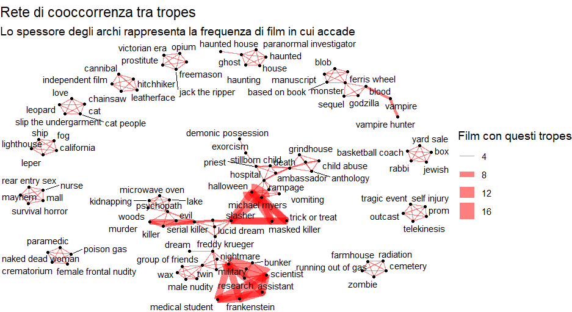
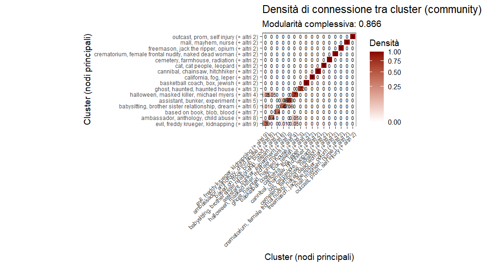

<h1 align="center">
     👻Progetto di Social Network Analysis sulla co-occorrenza dei trope nei film Horror👻
</h1>

<h2> For more information about this project check out <a href="https://auroracodingforfun.github.io/BlogSite/2026/10/11/Social-Network-Analysis.html"> my Blog</a>!</h2>

- Rplot.png ->Grafo 1
   
  
  
- Rplot01.png ->Grafo 2
   
  
- SNAProject.R->Complete R code with link to the Dataset
- Social Network Analysis Project.pdf ->Presentation and discussion
- SocialNetworkAnalysisProject.Rproj ->Rproj

<h4 align="center"> Final edit: I got 30/30 words can't express how happy I am :)</h4>

<h6 align="center"> ❤️ </h6>
